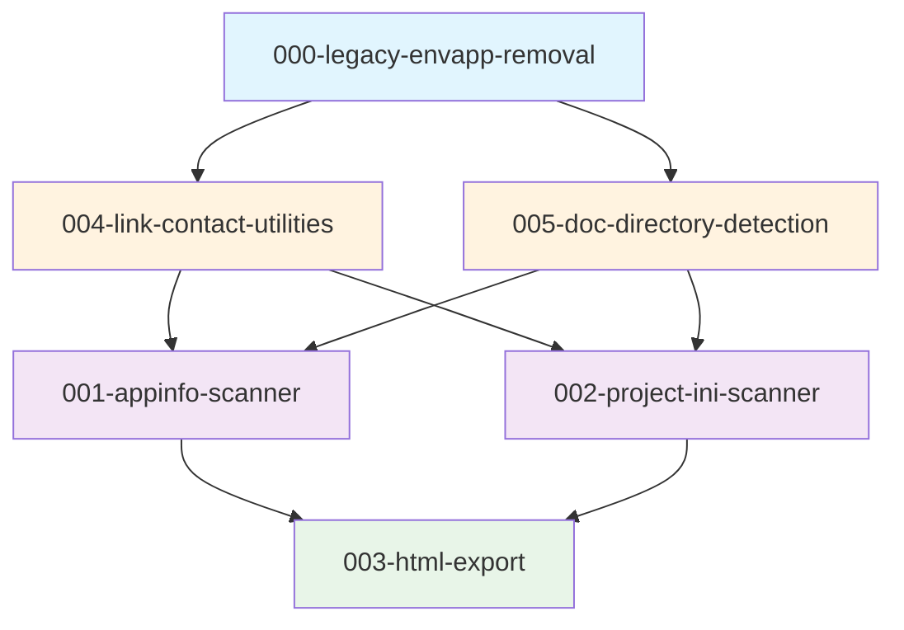

# Legacy env app list removal - Parent Tracking Issue

## Summary
Complete migration from legacy `envapplist.py` and `envmapplist.py` scripts by implementing all unported behaviors in the new modular zinfo architecture. This parent issue tracks the complete removal of legacy scripts and full feature parity.

## Background
The legacy scripts (`envapplist.py` and `envmapplist.py`) contain valuable functionality that was not fully ported during the migration to the new scanner architecture. These scripts provide:

- Support for multiple metadata formats (`appinfo.txt`, `project.ini`)
- HTML export functionality with styled tables
- Sophisticated link formatting and contact normalization
- Automatic documentation directory detection

The current new architecture only supports `zinfo.txt` format, leaving users dependent on legacy scripts for other formats.

## Current State Analysis

### ✅ Completed (New Architecture)
- Modular scanner architecture with `BaseScanner` ABC
- SQLite caching system for persistent indexing
- `zinfo.txt` format support with key-value parsing
- CLI commands for scan and query operations
- Comprehensive test suite with pytest

### ❌ Missing (Legacy Features)
- **appinfo.txt format support** - 3-line format used by environment applications
- **project.ini format support** - ConfigParser format used by map projects (currently broken in legacy)
- **HTML export functionality** - Styled table generation for web publishing
- **Link formatting utilities** - file:// URL generation and Windows path handling
- **Contact normalization** - @gov.yk.ca fallback for non-government contacts
- **Doc directory detection** - Automatic linking to Doc/ subdirectories

## Implementation Plan

### Phase 1: Foundation (Dependencies)
1. **Link Formatting and Contact Normalization Utilities** (Ticket #004)
   - Create reusable utility classes
   - Implement file:// URL generation
   - Add @gov.yk.ca contact fallback logic

2. **Doc Directory Detection** (Ticket #005)
   - Add automatic Doc/ subdirectory detection
   - Generate appropriate file:// links

### Phase 2: Scanner Extensions
3. **appinfo.txt Format Support** (Ticket #001)
   - Create `AppInfoScanner` class
   - Parse 3-line format (title, link, contact)
   - Integrate with existing scan command

4. **project.ini Format Support** (Ticket #002)
   - Create `ProjectIniScanner` class
   - Fix ConfigParser integration (currently broken in legacy)
   - Support [Project] section parsing

### Phase 3: Export Functionality
5. **HTML Export Functionality** (Ticket #003)
   - Add `export` CLI command
   - Generate styled HTML tables
   - Include JavaScript clipboard functionality

## Dependencies and Relationships

**Legend:**
- 🟨 Foundation utilities (Phase 1)
- 🟣 Scanner implementations (Phase 2)
- 🟩 Export functionality (Phase 3)

## Success Criteria

### Functional Requirements
- [ ] All legacy script functionality replicated in new architecture
- [ ] Multiple metadata formats supported (`zinfo.txt`, `appinfo.txt`, `project.ini`)
- [ ] HTML export generates identical output to legacy scripts
- [ ] Link formatting handles Windows paths and file:// URLs correctly
- [ ] Contact normalization applies @gov.yk.ca fallback appropriately
- [ ] Doc/ directories automatically detected and linked

### Quality Requirements
- [ ] Comprehensive unit test coverage for all new components
- [ ] Integration tests verify end-to-end functionality
- [ ] Cross-platform compatibility maintained
- [ ] Performance comparable to legacy scripts
- [ ] Error handling matches or exceeds legacy behavior

### Migration Requirements
- [ ] No breaking changes to existing functionality
- [ ] Gradual migration path for users
- [ ] Legacy scripts can be safely removed after implementation
- [ ] Documentation updated to reflect new capabilities

## Risk Assessment

### High Risk
- **HTML Export Compatibility**: Must match legacy output exactly for existing users
- **Windows Path Handling**: Critical for government environment compatibility

### Medium Risk
- **ConfigParser Integration**: Legacy script has known bugs that must be fixed
- **Link Formatting Edge Cases**: Complex Windows/UNC path scenarios

### Low Risk
- **Scanner Architecture**: Well-established pattern from existing `ZinfoScanner`
- **Utility Classes**: Straightforward extraction of existing logic

## Testing Strategy

### Unit Testing
- Individual component tests for all new classes
- Edge case testing for path handling and parsing
- Mock filesystem tests for directory detection

### Integration Testing
- End-to-end scan and export workflows
- Cross-format compatibility tests
- Performance benchmarking against legacy scripts

### User Acceptance Testing
- HTML output comparison with legacy scripts
- Real project data validation
- Windows environment testing

## Migration Timeline

### Immediate (Next Sprint)
- Implement foundation utilities (#004, #005)
- Begin scanner implementations (#001, #002)

### Short Term (1-2 Sprints)
- Complete scanner implementations
- Add HTML export functionality (#003)
- Comprehensive testing

### Long Term (Post-Migration)
- Legacy script deprecation notices
- User migration documentation
- Performance optimization

## Related Documentation
- [Architecture Overview](../../.kilocode/rules/memory-bank/architecture.md)
- [Project Context](../../.kilocode/rules/memory-bank/context.md)
- [Product Requirements](../../.kilocode/rules/memory-bank/product.md)

## Notes
- This parent issue represents the complete migration from legacy scripts
- Individual tickets contain detailed implementation specifications
- Progress should be tracked at both individual ticket and parent issue levels
- Consider creating a migration guide for users transitioning from legacy scripts
